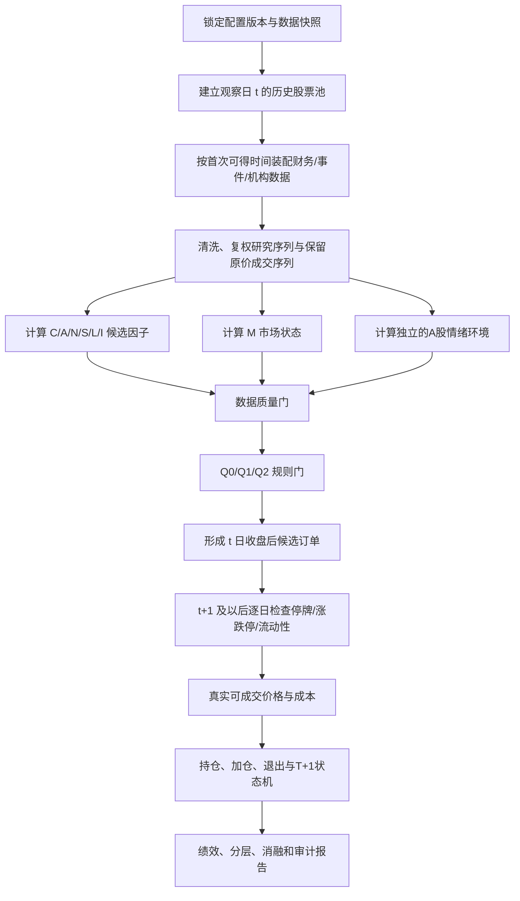
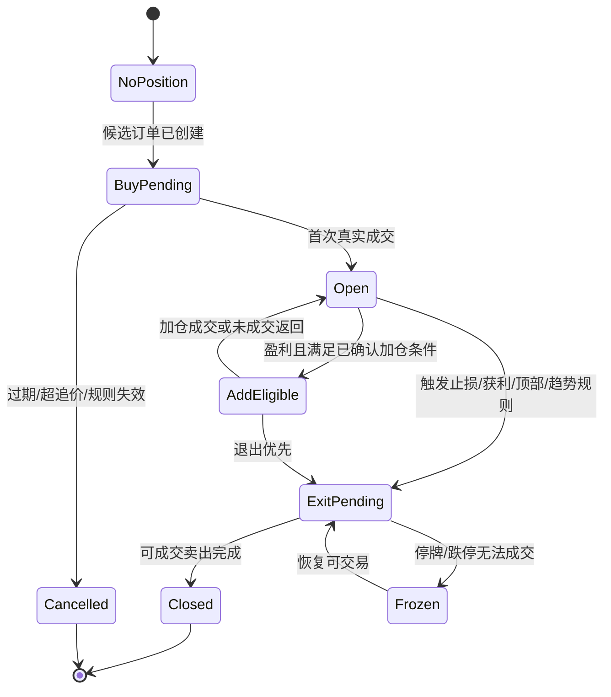

# 欧奈尔模型策略逻辑详细设计

> 文档性质：第三阶段正式代码之前的可执行逻辑规格。  
> 当前状态：**设计草案，D01—D14 尚未全部确认，不得直接视为最终策略参数**。  
> 策略定位：在原书方法基础上，分层研究其在A股的可量化子集；不等同于作者主观选股流程的完整自动化。  
> 结论边界：本文定义“如何研究”，不证明策略有效，也不构成投资建议。

> 实现更新：v0.4 已实现本文件的 Q0 可观测子集；具体代码基线见第31节。

## 1. 来源和决策标识

所有逻辑必须携带以下来源之一：

| 标识 | 含义 | 实现要求 |
|---|---|---|
| `O` | 原文明确提出 | 保存原文索引 ID 和出处；量化实现仍需说明是否存在换算 |
| `P` | 原文可以合理推导 | 保存推导依据，不能表述成作者给出的唯一算法 |
| `A` | 为适配A股新增 | 保存适配原因、制度版本和生效日期 |
| `U` | 当前无法确定 | 不得静默设为 `True`、零或行业常用默认值 |

本文继续使用 `04_量化框架分析.md` 的 D01—D14 决策 ID。尚未确认的参数以 `{CONFIG_REQUIRED}` 表示；它不是代码默认值。

## 2. 实现层级

### 2.1 Q0：硬规则骨架

可包含：

- C：点时可得的季度盈利与销售增长。
- A：点时可得的年度盈利历史。
- N：仅可观测的新高/价格突破子项。
- S：突破成交量和可获得的供给代理。
- L：个股和行业相对强度。
- M：经确认的市场状态代理。
- 经确认的枢轴点和突破约束。
- A股可成交、费用和风险规则。

Q0 必须显示“不含完整事件型 N、机构质量 I 和完整主观形态语义”，不能命名为完整 CAN SLIM。

### 2.2 Q1：形态层

`Q1 = Q0 + 经人工标注集验收的客观基底探测器`。

在 D11 未确认、标注集不存在或验收失败时，Q1 不可运行。不得以“过去一段时间创新高”冒充杯柄、平底或双底。

### 2.3 Q2：语义/机构层

`Q2 = Q1 + 点时事件型 N + 点时机构质量/趋势 I`。

事件和机构数据必须带首次公开时间；若只能取得后来整理的最终标签，Q2 不可用于历史回测。

## 3. 端到端流程



前一层未通过时，后一层仍可记录解释数据，但不能绕过门禁形成仓位。

## 4. 时间模型

### 4.1 必须区分的时间字段

| 字段 | 含义 |
|---|---|
| `report_period` | 财报或持仓报告覆盖的会计期间 |
| `event_time` | 公告、交易或状态变化实际发生时间 |
| `announcement_time` | 信息首次公开时间 |
| `vendor_available_time` | 数据供应商实际可交付时间；若未知须标记 |
| `effective_time` | 本研究允许该数据进入计算的最早时间 |
| `observation_time` | 因子观察截面，通常为交易日 `t` 收盘后 |
| `signal_time` | 所有信号条件已可知的时间 |
| `order_time` | 订单进入模拟市场的时间 |
| `fill_time` | 实际满足可成交条件的时间 |

### 4.2 基本有效时间规则

财务、事件和机构数据的基础映射：

```text
effective_time = next_tradable_time(
    max(announcement_time, vendor_available_time)
)
```

其中 `vendor_available_time` 缺失时不能假定等于报告期末；应按数据源验收结果选择保守延迟或标记 `INCOMPLETE`。

### 4.3 日线信号规则

若配置为收盘信号：

```text
observation_time = close(t)
signal_time      = after_close(t)
earliest_order   = session_open(t+1)
```

不得用 `close(t)` 生成信号后又按 `close(t)` 成交。若未来采用盘中信号，必须另建分钟级可得性与成交模型，不能沿用日线 OHLC 推断盘中先后顺序。

### 4.4 修订数据

财报或公告发生修订时：

- 修订前的历史截面保留当时值。
- 修订值仅从修订 `effective_time` 起生效。
- 禁止用数据库当前最终值覆盖过去。

## 5. 数据对象与主键

### 5.1 证券主数据

主键不只使用当前股票代码，应使用稳定证券 ID，并保存：

- 历史代码和名称区间。
- 上市、暂停上市、恢复上市和退市日期。
- 历史板块、ST/`*ST`/风险警示状态。
- 交易所与证券类型。
- 历史行业分类版本。

### 5.2 行情数据

至少包含：未复权 OHLC、成交量、成交额、前收盘、交易状态、涨跌停价、复权因子、总市值、流通市值和可流通股本。

- 连续收益、RS、形态研究使用明确口径的复权序列。
- 订单、涨跌停、跳空和真实盈亏使用未复权原价，并通过公司行动调整持仓数量与现金流。
- 复权价格不得直接用作成交价。

### 5.3 财务数据

至少保存证券 ID、报告期、报告类型、合并口径、字段值、公告时间、修订时间、数据版本和币种。累计报表拆分单季度时必须记录拆分来源。

### 5.4 事件与机构数据

每条记录必须有首次公开时间、来源、原始文本/记录引用、分类版本和置信度。没有点时字段时只能用于事后案例分析，不能进入历史信号。

### 5.5 制度数据

涨跌幅、费用、交易制度和板块规则必须按证券、日期和规则版本查询，不能使用一张覆盖所有历史时期的静态表。

## 6. 历史股票池

### 6.1 生成算法

对每个观察日 `t`：

```text
listed_t = securities whose listing_date <= t
active_or_historically_present_t = include securities according to their status at t
eligible_t = listed_t
             AND security_type_allowed(t)
             AND board_allowed(t)
             AND listing_age_rule(t)
             AND risk_warning_rule(t)
             AND liquidity_rule(t)
```

所有过滤均使用 `t` 当日状态。后来退市、改名或表现失败的股票不能从历史样本中删除。

### 6.2 待确认条件

- D01：沪深先行还是纳入北交所。
- D02：主板、创业板、科创板同池还是分开运行。
- D03：ST、`*ST` 和退市整理的买入/退出规则。
- 上市最短历史、流动性门槛和金融行业是否单独建模尚未形成最终决策。

未确认时，不生成正式股票池；诊断模式可以返回“因股票池规则未确认而无法判定”。

## 7. 数据质量门

在计算策略通过与否前，先给每只股票生成质量状态：

```text
COMPLETE     必需字段存在、时间可用、单位和口径通过校验
PARTIAL      仅可选模块缺失；能否继续由研究级别决定
INCOMPLETE   必需字段缺失或无法确认当时可见性
CONFLICT     多来源或多版本冲突且无已确认优先级
```

硬原则：

- 缺失不等于零。
- 无机构数据不等于机构持股为零。
- 负分母不自动产生高增长。
- 日期无法解析不回退到报告期末。
- 形态无法识别不等于形态通过。
- `CONFLICT` 和必需字段 `INCOMPLETE` 不得形成买入信号。

## 8. C：当期盈利与销售

### 8.1 候选字段

```text
eps_yoy_q   = (eps_q_t - eps_q_t_minus_4) / abs(eps_q_t_minus_4)
sales_yoy_q = (revenue_q_t - revenue_q_t_minus_4) / abs(revenue_q_t_minus_4)
```

公式是对同比要求的量化映射 `[O/P]`；阈值由原文索引和最终配置共同确定。

辅助字段：

- `eps_accel`：最近若干季度同比增速是否加速；算法窗口 `{CONFIG_REQUIRED}`。
- `sales_accel`：销售同比是否加速；容忍区间 `{CONFIG_REQUIRED}`。
- `margin_quality`：利润率自身历史位置及行业位置；口径 `{CONFIG_REQUIRED}`。

### 8.2 单季度拆分

A股累计披露需按同一口径拆分：

```text
Q2_single = H1_cumulative - Q1
Q3_single = Q1_to_Q3_cumulative - H1_cumulative
Q4_single = Annual - Q1_to_Q3_cumulative
```

拆分后的单季度数据只能在组成累计报表均已公开后使用；若前期报表后来修订，应按当时版本重建。

### 8.3 异常分母

依 D05，以下情况目前均为 `U`：前期 EPS 为负、为零、扭亏、币种/口径变化或并购导致不可比。正式实现前必须确认是剔除、单独反转分支还是其他规则。禁止把扭亏计算为无穷增长并自动通过。

### 8.4 法定与扣非

D04 未确认前同时保存法定 EPS 与扣非口径，但不得自行决定哪一个是硬门槛。任何扣非过滤都属于A股适配，不得标为原书唯一规则。

## 9. A：年度盈利历史

候选字段：

```text
annual_eps_up_3y = all(eps_y > 0) AND eps_y0 > eps_y1 > eps_y2
eps_cagr_3y      = (eps_latest / eps_start)^(1 / years) - 1
```

只有在起止 EPS 均为正且可比时计算 CAGR。其余返回不可比状态，不返回极端数值。

辅助字段：

- `roe_annual`：最新已披露年度加权平均 ROE。
- `cashflow_eps_gap`：经营现金流与 EPS 质量关系；金融行业需独立口径。
- `earnings_stability`：多年度增长波动或残差；这是替代量化方法 `[A]`，不能称作书中评分。

是否允许年度轻微回落、采用完整年度还是 TTM、稳定性窗口及金融行业处理仍需确认。

## 10. N：新因素与价格新高

### 10.1 Q0/Q1 可观测子项

```text
near_52w_high = adjusted_close_t / rolling_high_252_before_or_at_t
```

窗口和是否包含当日必须写入配置。该值只是“接近新高”的代理 `[P]`。

```text
new_high_breakout = valid_base
                    AND close_t crosses confirmed_pivot
                    AND extension_from_pivot <= configured_max_extension
```

若 `valid_base` 尚未实现，不得把它默认设为真。D08 未确认前，N 只能作为明确标注的价格子项。

### 10.2 Q2 事件型 N

候选事件包括产品、服务、管理层或行业条件变化，但原书未给出A股公告分类、文本模型或重要性阈值。Q2 需要：

1. 点时公告语料。
2. 预先冻结的事件分类体系。
3. 人工标注和一致性评估。
4. 只使用公告发布后信息。

没有这些条件时，事件型 N 状态为 `UNAVAILABLE`，而不是通过。

## 11. S：供给与需求

### 11.1 突破相对成交量

```text
breakout_rvol_t = volume_t / mean(volume from t-L to t-1)
```

均值窗口不包含突破当日，避免分母被当日放量污染。`L` 和通过阈值来自最终配置；原文中的放量幅度约束与量化窗口要分别记录来源。

### 11.2 柄部缩量

```text
handle_volume_ratio = mean(volume in confirmed_handle)
                      / mean(volume in confirmed_pre_handle_window)
```

只有形态模块已确认柄部区间时才计算；不能用未来形成的完整柄部边界回写到较早日期。

### 11.3 A股供给代理

可研究流通股本、自由流通市值、股东户数变化、回购、增发、解禁和可转债稀释，但字段和方向组合属于 `A/P/U`。各事件只从首次公告或生效可见时点进入，不能按今天的最终股本重算过去。

不设置“市值越小越好”的无条件单调规则。

## 12. L：领导股与相对强度

### 12.1 个股 RS

```text
return_252_i_t = total_return(i, t-252 ... t)
rs_52w_i_t     = percentile_rank(
    return_252_i_t among eligible universe at t
)
```

横截面必须是 `t` 日历史股票池，且处理最短历史与停牌期。RS 百分位的具体排序、并列值和缺失策略写入配置。

### 12.2 行业 RS

```text
industry_return_g_t = aggregate historical-member returns for industry g at t
industry_rs_g_t     = percentile_rank(industry_return_g_t)
```

行业分类使用历史版本。聚合方法、成分最低数量和基准属于A股实现参数，未确认时标记 `U`。

### 12.3 输出方式

同时保留连续分位和阈值通过状态，以测试高阈值、相对宽松阈值、个股/行业二维组合。不得只报告事后表现最好的一档。

## 13. I：机构认同

候选字段可包括机构持股比例、机构数量、较上期变化、基金首次进入、拥挤度和机构历史表现。它们属于A股代理，不自动等同于原书所说的“优质机构认同”。

点时规则：

```text
institution_value_t = latest disclosed record
                      whose effective_time <= observation_time_t
```

D09 未确认前：

- Q0/Q1 显示 I 缺失或仅作分层分析。
- 不得作为隐含硬门槛。
- 不得使用北向资金、龙虎榜或当前基金持仓替代历史机构质量。

Q2 若启用，必须确认机构范围、披露滞后、质量评分、拥挤度定义和缺失处理。

## 14. M：市场方向

### 14.1 派发日候选

```text
distribution_day_t = index_return_t <= -0.2%
                     AND market_activity_t > market_activity_t_minus_1
distribution_count_t = count(distribution_day in configured rolling window)
```

`-0.2%` 来源为原文参数，滚动窗口换算、采用成交量还是成交额、指数选择和派发日失效规则仍需 D10 确认。

### 14.2 跟进日候选状态机

```text
CORRECTION
  └─ index_up_day_after_low → RALLY_ATTEMPT(day=1)
       ├─ undercut_low → CORRECTION
       ├─ advance_day_counter
       └─ strong_gain_with_higher_activity_on_allowed_day
            → FOLLOW_THROUGH_CANDIDATE
                 ├─ confirmation rules pass → CONFIRMED_UPTREND
                 └─ failure/reset rule → CORRECTION or UNDER_PRESSURE
```

“重要低点”、允许日序、强势涨幅、量/额口径、失败重置和多指数合成均为 `P/A/U`，没有确认前不得输出确定性 M 状态。

### 14.3 多指数

D10 的候选包括上证综指、深证成指、创业板指和科创50。需要分别保存每个指数状态，再由已确认规则决定：任一确认、加权投票、按股票所属板块匹配或其他组合。不能由代码默认多数票。

## 15. A股情绪环境

本模块完全独立于原书 M，统一标为 `A`，目的是检验A股环境是否影响信号可用性，而不是把情绪历史改写成原书规则。

### 15.1 候选指标

- 宽度：上涨家数占比、站上中期均线占比、新高/新低比。
- 涨跌停：涨停数、跌停数、炸板率、连板高度。
- 流动性：全市场成交额及历史分位、换手率。
- 风险偏好：融资余额变化、板块扩散、领导行业集中度。

### 15.2 三种实验角色

每项指标只允许一种已声明角色：

```text
DISPLAY_ONLY      仅解释，不影响信号
ENTRY_FILTER      作为买入门控
EXPOSURE_MODIFIER 调整组合总暴露
```

在阈值、窗口和映射未确认前，只能使用 `DISPLAY_ONLY`。若构造合成情绪分，权重必须在训练区间内确定并冻结，样本外不得重估。

### 15.3 可奏效性的判断标准

是否奏效只能通过实验回答：

1. 与不使用情绪模块的同信号对照。
2. 按牛熊、流动性和注册制阶段分层。
3. 滚动训练/验证/样本外。
4. 计入不可成交和完整成本。
5. 检查参数邻域和不同数据源稳定性。

若只改善样本内收益、依赖少数极端行情或显著增加换手，不得表述为有效。

## 16. 形态与枢轴点

### 16.1 接口状态

D11 未确认前，形态模块只提供以下接口状态：

```text
NOT_EVALUATED    未启用形态模块
EXTERNAL_LABEL   使用观察日当时已经形成的外部/人工标签
VALID            经确认算法识别且通过
INVALID          经确认算法识别但不通过
AMBIGUOUS        多个候选或数据不足
```

### 16.2 杯柄候选约束

原书能够约束的内容，如形成前上涨、基底时长/深度、U 形、柄部时长/深度/位置、缩量、放量突破和买点延伸，应按 `03`、`04` 文档中的原文索引进入参数表。

但以下算法原文未唯一规定：

- 波峰波谷识别。
- U 形与 V 形数值定义。
- 紧密、松散和楔形的精确阈值。
- 候选形态重叠时的选择。
- 失败形态何时失效。

因此不能在本设计中擅自指定平滑器、极值阶数或机器学习模型。

### 16.3 验收方法

正式启用前至少需要：正例、失败例、随机负例；双人复核或明确仲裁；报告精确率、召回率和分歧案例；参数邻域稳定性；时间切分验证。形态收益不是唯一验收标准。

## 17. 信号门禁与结果状态

### 17.1 规则顺序

```text
1. universe_gate
2. data_quality_gate
3. C_gate
4. A_gate
5. N_gate_for_research_level
6. S_gate
7. L_gate
8. I_gate_or_explicit_missing_state
9. M_gate
10. pattern_and_pivot_gate
11. A_share_entry_policy_gate
12. candidate_order_creation
```

### 17.2 逻辑骨架

```text
candidate_t = universe_pass
           AND data_quality_pass
           AND C_pass
           AND A_pass
           AND N_required_pass
           AND S_pass
           AND L_pass
           AND I_requirement_satisfied_for_level
           AND M_allows_entry
           AND pattern_requirement_satisfied_for_level
           AND breakout_near_pivot
```

这是研究逻辑骨架 `[P]`，不是已经确认的完整规则。若某项对当前 Q 级别是必需项而状态未知，结果是 `INCOMPLETE`，不是 `PASS`。

### 17.3 输出状态

| 状态 | 含义 |
|---|---|
| `PASS` | 在当前 Q 级别和配置下形成候选订单 |
| `REJECT` | 至少一项已计算硬门槛失败 |
| `INCOMPLETE` | 必需数据、规则或时间可得性无法确认 |
| `UNTRADABLE` | 信号通过，但指定执行窗口内无法成交 |

每个结果保存全部失败原因，不只保存第一个失败原因；同时记录首个门禁失败位置用于流程解释。

### 17.4 禁止隐式总分

原书框架包含多项必要条件，本设计不默认采用线性加权总分。若未来研究软评分，必须作为单独的 `P/A` 实验，并与硬门禁版本分开报告。

## 18. 订单与成交

### 18.1 候选订单

收盘信号仅创建候选订单：

```text
CandidateOrder {
  security_id,
  signal_time,
  earliest_order_time,
  pivot_price,
  max_entry_price,
  desired_quantity,
  expiry_rule,
  config_hash,
  evidence_ids
}
```

仓位和订单有效期尚未确认时，不得产生正式数量与过期时间。

### 18.2 每日可交易检查

按顺序检查：

1. 是否交易日且证券挂牌有效。
2. 是否停牌或无报价。
3. 当日涨跌停制度版本与限价。
4. 是否一字涨停/无可卖量导致买入不可成交。
5. 开盘或第一可成交价是否超过最大追价范围。
6. 成交量参与率是否允许目标数量。
7. 费用和现金是否足够。

若失败，记录明确原因。订单是取消、继续排队还是到期，须由配置确定。

### 18.3 成交价格

基础设计为“下一交易日第一可成交价格”，但其具体实现仍需确认：开盘价、VWAP、开盘后若干分钟成交或日线保守估计。没有分钟数据时，不能声称识别了日内先后顺序。

### 18.4 涨跌停

- 一字涨停且无可成交量：买入不成交。
- 触发止损但一字跌停：卖出不成交，订单排队至首次可成交。
- 普通涨跌停且存在成交：是否部分成交由参与率模型确定。
- 限价按当时板块、风险状态和制度日期查询。

## 19. 持仓与风控状态机



### 19.1 T+1

新买入或当日新增的可售数量按A股制度锁定至下一交易日。即使当日触发理论止损，也只能记录风险事件，不能虚构当日卖出。

### 19.2 初始止损

原书明确提出约 7%—8% 初始止损 `[O]`，但 D07 尚未确认具体百分比及基于首次买价还是加权成本。代码不得自行选择 7%、8% 或其中点。

触发价格与实际成交价格分开：

```text
stop_triggered = observable_price <= stop_level
realized_exit  = first later tradable fill after trigger
```

### 19.3 加仓

原书强调只向上加仓且后续仓位更小。初始仓位、盈利触发、加仓层数和比例由 D06 决定。未确认时可运行“无加仓研究基准”仅在用户明确确认后使用，不能把它当作原书完整执行。

### 19.4 退出模块

初始止损、早期失败、一般获利、快速赢家例外、顶部异常、趋势破坏、相对弱势和时间退出必须作为独立事件记录。多个规则同时触发时，需要明确优先级；未确认前不得事后选收益更高的退出方式。

### 19.5 组合约束

D13 决定最大持仓、单票、行业和不同 M 状态下的总仓位。未确认前只可计算候选信号，不生成组合级回测结果。

## 20. 公司行动

每日事件处理原则：

1. 在交易开始前应用已生效的分红、送转、拆并股、配股等公司行动。
2. 调整持仓数量、成本基准、枢轴/止损参考和现金流。
3. 研究序列使用一致复权口径重新计算连续指标。
4. 当日成交仍使用原价和当日限价。

现金分红是组合现金流，不应同时通过价格复权和现金入账重复计收益。公司行动缺失或比例冲突时，该持仓进入数据质量警告或阻断状态。

## 21. 事件驱动回测顺序

每个交易日建议按以下事件顺序执行；其中同日高低价冲突的细节仍需确认：

```text
PRE_OPEN
  1. 应用公司行动和制度版本
  2. 更新可售数量、停牌和证券状态
  3. 处理上日遗留卖出订单
  4. 处理上日候选买入订单

IN_SESSION / DAILY_APPROXIMATION
  5. 检查持仓风险触发与可成交性
  6. 记录部分成交、失败成交和滑点

AFTER_CLOSE
  7. 用截至收盘可得信息更新因子和 M/情绪
  8. 生成下一交易日候选订单
  9. 盯市、费用、现金和审计快照
```

若只有日线 OHLC 且同日最高价触发止盈、最低价触发止损，无法知道先后。必须选择并声明：使用分钟数据、采用保守优先级或将该日标为歧义并做上下界测试。不得挑选更有利顺序。

## 22. 交易成本

```text
net_fill_cost = commission
              + minimum_commission_effect
              + transfer_fee_if_applicable
              + exchange_or_regulatory_fee
              + sell_side_stamp_tax
              + slippage
              + market_impact
```

要求：

- 税费按历史生效日期版本化。
- 佣金、最低佣金和账户规模来自 D12。
- 滑点与成交额参与率、开盘跳空、涨跌停状态相关。
- 买卖成本方向分开。
- 费用项目去重。
- 报告低/中/高成本压力测试须由 D12 确认，不提供单一理想净收益。

## 23. 可配置化边界

### 23.1 必须配置化

- 股票池和板块范围。
- 财务口径、窗口、阈值和异常分母处理。
- RS 窗口、横截面、阈值和行业分类。
- M 指数、量/额口径、窗口和状态机参数。
- 情绪指标启用角色、窗口和阈值。
- 形态算法版本和参数。
- 信号/订单时点、最大追价和订单有效期。
- 仓位、加仓、止损、退出和组合约束。
- 费用、滑点、参与率和制度版本。
- 训练、验证、样本外区间。

### 23.2 不允许随意配置化

以下内容是研究完整性硬约束，不提供关闭开关：

- 禁止未来数据。
- 财务数据按公告可得时间生效。
- 历史股票池保留退市股票。
- 复权研究价与真实成交价分离。
- 停牌和不可成交不能强制成交。
- 交易成本不能在净收益报告中关闭而不显著标记。
- 缺失值不能默认通过。
- 配置与数据快照必须版本化。

### 23.3 配置版本

每次运行保存：

```text
config_version
config_hash
source_document_versions
data_snapshot_id
code_commit_or_build_id
calendar_and_rule_versions
run_id
```

参数修改产生新版本，不覆盖历史结果。

## 24. 验证设计

### 24.1 时间切分

训练、验证和样本外按时间顺序排列，不随机打乱。参数只在训练期形成，验证期冻结，样本外只评估一次。具体区间和滚动方式属于 D14/实验配置。

### 24.2 对照和消融

至少比较：

- 可投资股票池等权与宽基指数。
- 单纯新高/动量。
- 单纯盈利增长。
- Q0、Q1、Q2。
- 删除 C/A/N/S/L/I/M 单个模块的消融。
- 启用与不启用A股情绪模块。
- 不同板块、规模、行业、流动性和 M 状态。

比较必须使用相同股票池、时期、成交和成本口径。

### 24.3 绩效输出

收益、风险、风险调整、交易结构、执行、容量和稳健性指标按 `04_量化框架分析.md` 输出。必须额外报告：

- 信号数、成交数和有效独立交易数。
- 未成交率与原因分布。
- 涨跌停和停牌造成的损失/延迟。
- 数据不完整样本数。
- 前十大盈利交易贡献。
- 参数邻域而非单一点表现。

D14 未定义成功标准前，只能描述研究结果，不能判定“可实盘”。

## 25. 审计事件

每个候选和订单至少记录：

```text
UNIVERSE_INCLUDED / UNIVERSE_EXCLUDED
DATA_MISSING / DATA_CONFLICT / DATA_NOT_YET_AVAILABLE
FACTOR_PASS / FACTOR_FAIL / FACTOR_NOT_EVALUATED
MARKET_STATE_CHANGED
SIGNAL_CREATED / SIGNAL_REJECTED
ORDER_CREATED / ORDER_EXPIRED / ORDER_CANCELLED
FILL_COMPLETE / FILL_PARTIAL / FILL_BLOCKED
STOP_TRIGGERED / EXIT_TRIGGERED
CORPORATE_ACTION_APPLIED
CONFIG_VALIDATION_FAILED
```

事件包含时间、证券、规则 ID、来源标签、输入值、阈值、结果、配置哈希和数据引用。日志不得只存自然语言，需同时有结构化字段。

## 26. 伪代码

### 26.1 截面筛选

```text
function screen(as_of_date, frozen_config, data_snapshot):
    validate_config(frozen_config, mode="screen")
    assert snapshot_covers(as_of_date)

    universe = build_point_in_time_universe(as_of_date, frozen_config.universe)
    market = compute_market_state(as_of_date, frozen_config.market)
    sentiment = compute_sentiment_display_or_gate(as_of_date, frozen_config.sentiment)

    results = []
    for security in universe:
        point_in_time_data = load_data_available_by(security, as_of_date)
        quality = validate_data(point_in_time_data, frozen_config.research_level)
        if quality.blocks_signal:
            results.append(INCOMPLETE with evidence)
            continue

        factors = compute_factors(point_in_time_data, market, frozen_config)
        decision = apply_ordered_gates(factors, frozen_config)
        tradability_preview = inspect_next_session_constraints_without_assuming_fill()
        results.append(decision with all evidence)

    persist(run_metadata, results, quality_events)
    return results
```

### 26.2 回测

```text
function backtest(date_range, frozen_config, data_snapshot):
    validate_config(frozen_config, mode="backtest")
    assert no_required_decision_is_unresolved()

    for trading_day in date_range:
        apply_corporate_actions(trading_day)
        refresh_historical_security_states(trading_day)
        process_pending_exits_first(trading_day)
        process_pending_entries(trading_day)
        evaluate_intraday_or_declared_daily_risk_model(trading_day)
        mark_positions_and_costs(trading_day)
        screen_after_close_and_queue_future_orders(trading_day)
        persist_daily_audit_snapshot(trading_day)

    calculate_metrics_without_retuning_parameters()
    return research_report
```

伪代码中的执行先后仍须通过分钟数据选择和退出优先级确认后才能落地。

## 27. 测试不变量

实现后必须至少保证：

1. 把公告日向后移动一天，公告日前因子不得变化。
2. 把退市股票加入历史数据，不会因当前不在列表而消失。
3. 删除必需字段，结果变为 `INCOMPLETE` 而不是 `PASS`。
4. 收盘信号不能按同日收盘成交。
5. 一字涨停买单不成交，一字跌停卖单不成交。
6. T+1 下当日新增仓位不可卖。
7. 分红送转前后组合价值不会被重复计入。
8. 修改未来数据不会改变过去信号。
9. 修改 UI 列偏好不会改变配置哈希和策略结果。
10. 同一配置、数据快照和代码版本重复运行结果一致。
11. 未启用的 N/I/形态模块被标记，而不是默认为通过。
12. M 与A股情绪的来源和结果字段不会混合。

## 28. 与代码模块的映射

| 本文逻辑 | 目标模块 | 对应 `06_代码设计说明.md` |
|---|---|---|
| 配置、版本和门禁 | `config.py` | 5.1 |
| 点时数据和快照 | `data.py` | 5.2 |
| 清洗、复权与公司行动 | `cleaning.py` | 5.3 |
| C/A/N/S/L/I/M | `factors.py` | 5.4 |
| 基底与枢轴 | `patterns.py` | 5.5 |
| 顺序门禁 | `signals.py` | 5.6 |
| 订单和可成交 | `execution.py` | 5.7 |
| 持仓与风险 | `risk.py` | 5.8 |
| 事件循环 | `backtest.py` | 5.9 |
| 指标和研究报告 | `performance.py` | 5.10 |
| UI 和接口契约 | `08_欧奈尔模型_UI设计说明.md` | 新增界面层 |

## 29. 待确认清单与代码门

### 29.1 阻止任何正式策略代码

- G-001：`00_项目总则.md` 缺失，治理要求无法核对。
- D01—D05：股票池和核心财务口径未确认。
- D08—D11：N、I、M 和形态范围未确认。

### 29.2 阻止组合回测

- D06、D07：仓位、加仓和止损基准未确认。
- D12：账户规模、费用、滑点和容量未确认。
- D13：组合暴露未确认。

### 29.3 阻止“通过验收/可实盘”结论

- D14：样本外收益、最大回撤、换手和容量标准未确认。

在这些决策完成前，可以实现通用数据结构、配置校验器、只读 UI 壳层和不包含策略取舍的反偏差测试基础设施；但若严格遵循用户当前规则，仍应先获得确认再写正式策略模块。

## 30. 当前已知限制

- EPUB 定位与纸质页码可能不一致，原文出处仍以 `01_原文索引与出处.md` 的定位方式为准。
- 原书包含定性判断，无法无损地完全自动化。
- A股机构披露、事件文本和历史制度数据的点时质量尚未验收。
- 日线数据无法可靠判断同一交易日内多个价格触发的先后。
- 形态算法和人工标注集尚未建立。
- A股情绪是否有样本外增益尚未验证。
- 任何回测结果都可能受数据源、参数、成本、容量和市场制度变化影响。

## 31. v0.4 Q0 代码语义

首批代码采用以下显式布尔门：

```text
C = eps_yoy_q >= 25% AND sales_yoy_q >= 25%
A = annual_eps_up AND annual_eps_cagr >= 25% AND annual_roe >= 17%
N_observable = near_52w_high >= 0.85 AND crosses_prior_252d_high
S = volume_t / mean(volume_t-50 ... volume_t-1) >= 1.4
L = percentile_rank(252d_continuous_return) >= 80

q0_observation_pass = data_complete AND C AND A AND N_observable AND S AND L
complete_oneil_status = INCOMPLETE
```

来源说明：25%、17%、1.4和80来自原书明确范围；同比/CAGR/RS机器公式属于合理推导；0.85、50日窗口、连续收益指数和A股股票池是推导或A股/新增研究假设。完整形态、I和M门控保持未评估。

### 31.1 数据语义

- Tushare 为主源；AkShare/Eastmoney只作兜底；
- 财务记录要求 `ann_date <= as_of_date`；
- AkShare财务标记修订风险并阻止财务完整；
- 研究价格用 Tushare `pct_chg` 连乘的连续指数，原价保留给交易检查；
- 股票池尝试包含当时已上市且尚未退市的 L/D/P 证券；当前名单兜底会触发生存者风险。

### 31.2 状态语义

- `PASS`：仅Q0已实现门通过；
- `REJECT`：至少一个已计算规则明确失败；
- `INCOMPLETE`：必需数据、点时属性或实现模块不足；
- `complete_oneil_status` 在 v0.4 固定为 `INCOMPLETE`。

### 31.3 未开放回测

`OneilBacktestEngine.run()` 当前显式拒绝执行，因为 D06、D07、D12、D13 和同日触发顺序未确认。这样可以避免复用现有通用回测器中10日持有、固定止盈、单一止损和成本等不属于本模型已确认逻辑的默认值。
